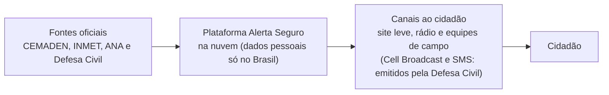
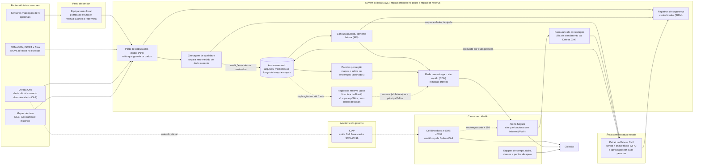

# Alerta Seguro: informação por endereço e orientação de ação para alertas de chuva intensa em áreas de várzea e de encosta de São Paulo

## Integrantes

| Nome completo (ordem alfabética) | GitHub | Área de carreira | RGM |
|---|---|---|---|
| Alessandra Guimarães da Silva | @Allessandra02 | Cibersegurança | 47918772 |
| Davi Pereira de Oliveira Silva | @Davi-Pereira2z | Cloud Computing | 47857013 |
| Ellen Cristina Soares de Jesus | @Ellen-Soares | Cloud Computing | 47795387 |
| Samuel Guimarães da Silva | @Samuel-Guimaraes345 | Cloud Computing | 48039501 |

**Dossiê:** 8 – Alertas climáticos e infraestrutura resiliente

**Recorte:** alertas de chuva intensa (alagamentos, inundações e deslizamentos), com um módulo informativo sobre calor extremo; piloto na cidade de São Paulo (áreas de várzea e de encosta), com arquitetura nacional replicável. A justificativa está na seção 1.1.

## 1. Análise do problema

> **Em resumo:** para um alerta de chuva funcionar, várias etapas precisam dar certo em sequência. Hoje o aviso muitas vezes chega sem dizer qual rua está em risco, para onde ir e a quem pedir ajuda, e algumas pessoas nem chegam a recebê-lo. A proposta ocupa esse "último metro" entre o alerta e a ação.

### 1.1 Quem é afetado, onde e quanto

**O problema, em uma frase.** Para um alerta de chuva chegar a tempo, várias etapas precisam funcionar em sequência: sensores, previsão, decisão da Defesa Civil, envio da mensagem e o celular da pessoa. Se uma etapa falha, o aviso chega atrasado, chega sem dizer o que fazer ou não chega a quem mais precisa.

Os dados abaixo vêm principalmente do CEMADEN (Centro Nacional de Monitoramento e Alertas de Desastres Naturais), órgão federal que acompanha a chuva e envia alertas técnicos às Defesas Civis. Eles estão agrupados por pergunta. O principal canal oficial de alerta é o *Cell Broadcast*: uma mensagem que aparece na tela do celular, com som, sem precisar de cadastro, mas que só chega a aparelhos compatíveis.

**Quanto**

| Número | O que significa | Fonte |
|---|---|---|
| 2.505 | Alertas de risco ligados à chuva (enchentes, inundações e deslizamentos) emitidos pelo CEMADEN em 2025, para 1.133 municípios monitorados | [1] |
| 1.493 | Ocorrências de desastres registradas em 2025 | [1] |
| 336.656 | Pessoas diretamente afetadas por eventos climáticos extremos em 2025 | [2] |
| R$ 3,9 bilhões | Prejuízos causados por esses eventos | [2] |
| 2.095 de 5.570 | Municípios brasileiros expostos a riscos geo-hidrológicos (ligados a chuva e relevo) | [2] |
| 8,9 milhões | Pessoas que moram em áreas de risco no país (dado do CEMADEN citado pela Confederação Nacional de Municípios) | [3] |

**Onde**

| Número ou fato | O que significa | Fonte |
|---|---|---|
| Cerca de metade dos alertas e 43% das ocorrências | Estão concentrados no Sudeste | [1] |
| Minas Gerais, São Paulo e Amazonas | Estados com mais alertas extremos enviados por Cell Broadcast no 1º semestre de 2026 | [4] |
| 11 de junho de 2026 | Data em que o El Niño (aquecimento das águas do oceano Pacífico, que altera o clima em várias regiões) foi oficialmente estabelecido; o governo federal prevê um El Niño muito forte, com impactos diferentes em cada região | [5] |

**Quem é afetado.** Moradores de várzeas e encostas (em geral, áreas de ocupação precária), idosos, pessoas com deficiência, crianças, trabalhadores ao ar livre e a própria Defesa Civil, que precisa chegar ao morador antes do desastre.

**Quem pode ficar sem o alerta**

| Número ou fato | O que significa | Fonte |
|---|---|---|
| Aparelhos com 4G ou 5G, em geral lançados a partir de 2020 | Só esses recebem o Cell Broadcast, e só quando não estão conectados apenas ao Wi-Fi | [8][9] |
| Cadastro por CEP (código postal) | O SMS 40199 só envia alertas a quem se cadastrou antes | [10] |
| 86% | Domicílios brasileiros com internet em 2025 | [11] |
| 59% | Pessoas com 60 anos ou mais que usam a internet | [11] |
| 28 milhões | Pessoas que não usam a internet (mais da metade tem 60 anos ou mais) | [11] |
| 65% | Usuários que acessam a internet só pelo celular | [11] |
| 39% | Usuários que ficaram sem pacote de dados nos 3 meses anteriores (54% entre quem tem plano pré-pago) | [11] |
| 14,4 milhões | Pessoas com deficiência no Brasil em 2022 (7,3% da população com 2 anos ou mais) | [12] |
| 7,9 milhões | Dessas, pessoas com dificuldade para enxergar | [12] |

> **Nota sobre o número de pessoas com deficiência.** A aula de Inclusão e Acessibilidade cita 18,6 milhões (8,9% da população); este trabalho usa o Censo 2022 do IBGE: 14,4 milhões, 7,3% da população com 2 anos ou mais [12]. As pesquisas do IBGE têm metodologias diferentes, por isso os números diferem.

**Caso extremo: enchentes no Rio Grande do Sul, em 2024**

| Número | O que significa | Fonte |
|---|---|---|
| Mais de 2,3 milhões | Pessoas afetadas | [6][7] |
| Mais de 422 mil | Pessoas que precisaram deixar suas casas | [6][7] |
| Cerca de 180 | Mortes (182 segundo a IFRC, federação internacional da Cruz Vermelha; 185 no balanço do estado) | [6][7] |

**Notas**

- Os números vêm de registros de monitoramento e não representam todos os desastres que aconteceram.
- Os 2.095 municípios expostos e os 1.133 monitorados medem coisas diferentes e não podem ser comparados diretamente. Mesmo assim, apontam para uma lacuna: o monitoramento não cobre todo o risco.
- As fontes divergem sobre as mortes no Rio Grande do Sul por causa da data de corte e do conceito usado. Por isso, os números não devem ser somados.

**Recorte adotado.** Alertas de chuva intensa (alagamento, inundação e deslizamento), com um módulo informativo de calor extremo, em piloto na cidade de São Paulo. Justificativa:

- os alertas do CEMADEN tratam de risco ligado à chuva (alagamentos, inundações e deslizamentos) [1];
- é nesse tipo de evento que a ação do morador nos minutos seguintes ao alerta (sair da área baixa, afastar-se da encosta) tem efeito direto;
- São Paulo está entre os estados com mais alertas extremos em 2026 [4], e a capital tem mapas públicos de áreas de risco (GeoSampa, portal de mapas da Prefeitura) [13] e um centro próprio de gerenciamento de emergências, o que permite um piloto com dados reais;
- um recorte menor permite testar com a Defesa Civil antes de ampliar;
- o módulo de calor extremo é apenas informativo e não é quantificado nesta versão; o contexto vem do CEMADEN, que registrou sete ondas de calor no Brasil em 2025 e aponta ondas de calor cada vez mais frequentes e intensas nos próximos anos [1].

A arquitetura e os dados são nacionais, de modo que levar a solução a outros municípios não exige refazer o projeto.

### 1.2 Causas

**Causas físicas e territoriais (contexto, não tecnológicas).** Solo impermeabilizado, drenagem insuficiente, ocupação de várzeas e encostas, cortes e aterros sem projeto e lixo em galerias. Um temporal é um fenômeno da atmosfera; o desastre nasce quando ele encontra pessoas expostas e vulneráveis. Por isso, sensores e alertas ajudam a avisar com mais antecedência, mas não substituem drenagem, contenção de encostas e moradia segura (ver 2.4).

**Causas tecnológicas e de projeto (foco desta proposta).**

1. **Cobertura desigual de sensores.** Pluviômetros e sensores medem pontos isolados. Uma encosta pode ter condições diferentes a poucos metros de distância, e a previsão para o município não diz qual rua alaga. Há mais municípios expostos do que monitorados (ver 1.1).
2. **Alerta que diz "o quê", mas não "onde" nem "para onde ir".** O Cell Broadcast é um texto curto, enviado a todos os aparelhos compatíveis das áreas escolhidas [8][9]. Cabe pouca coisa nele: o risco por endereço, o mapa e a lista de telefones precisam estar em outro lugar. A própria mensagem de demonstração do sistema já manda o morador consultar um site ("Mais informações, consulte o site do Defesa Civil Alerta") [16].
3. **Muitos canais e muitos órgãos.** Há SMS 40199, WhatsApp, Telegram, Cell Broadcast, TV por assinatura e Alertas Públicos do Google [10][17]. Cada etapa também é de uma instituição diferente: o CEMADEN gera o alerta técnico, o CENAD (Centro Nacional de Gerenciamento de Riscos e Desastres) e a Defesa Civil o divulgam, e o INMET (Instituto Nacional de Meteorologia) emite avisos meteorológicos, que não são alertas de Defesa Civil [18]. Para o morador, fica a dúvida: qual mensagem é oficial e o que fazer?
4. **Dependência de energia e de rede.** O Cell Broadcast depende da antena: só recebe quem está com aparelho compatível, ligado e sob cobertura 4G ou 5G [8]. Se a antena fica fora do ar, o alerta não chega a quem depende dela. Aplicativos e sites também param. O efeito em cascata é este: a chuva derruba a energia, a antena sai do ar, os sensores deixam de enviar leituras, o centro de monitoramento perde a visão da situação e o morador perde o aviso.
5. **Segurança do sistema que dispara os alertas.** Em 20 de junho de 2026, a plataforma nacional de emissão de alertas (IDAP, Interface de Divulgação de Alertas Públicos) sofreu um acesso indevido e foram disparadas dez mensagens não autorizadas, nove por Cell Broadcast e uma por SMS. A plataforma foi retirada do ar às 1h30 da madrugada e a Polícia Federal abriu investigação [19][20]. O caso mostra que o canal de telecomunicações pode funcionar perfeitamente e, mesmo assim, entregar uma mensagem falsa: proteger o caminho da mensagem e garantir a autenticidade de quem a enviou são controles diferentes.
   *Nota:* documentos da Secretaria Nacional de Defesa Civil, noticiados pela imprensa, indicam que as duas contas usadas nos disparos pertenciam a usuários da Defesa Civil do Pará e foram empregadas fora da área autorizada. O balanço inicial divulgado pela imprensa falou em cerca de 30 milhões de pessoas atingidas [21][22]. Esses detalhes não constam de comunicado oficial e a autoria segue sob investigação; por isso, o grupo não atribui uma causa-raiz.
6. **Dados abertos pouco usados no momento do alerta.** Existem o Mapa Interativo do CEMADEN [15], os mapas de risco do município (GeoSampa) [13], o GeoRisk (previsão de risco de deslizamento com até 72 horas, de apoio à Defesa Civil) [24] e o Google Flood Hub (previsão de inundação em vários países, inclusive no Brasil, de caráter complementar) [25]. São ferramentas úteis, mas técnicas, separadas entre si e desligadas da mensagem que o morador recebe.
7. **Fadiga de alerta.** Mensagens em excesso, genéricas ou imprecisas fazem as pessoas ignorarem o aviso verdadeiro (ver o "cuidado ético central" do dossiê).

### 1.3 O que já existe e por que não basta

| O que existe | O que faz | Por que não basta |
|---|---|---|
| Defesa Civil Alerta (Cell Broadcast) | Mostra uma mensagem na tela, com som, para aparelhos compatíveis na área de risco, sem cadastro; é usado em alertas severos e extremos [8][26] | O texto é curto e não traz mapa nem telefones. Não chega a aparelho incompatível, desligado, sem cobertura 4G/5G [8] |
| SMS 40199 | Envia alertas por CEP cadastrado e funciona em celular simples [10] | Exige cadastro prévio e CEP atualizado; o texto é curto [10] |
| WhatsApp, Telegram e aplicativos | Permitem consultar alertas e orientações [10] | Exigem smartphone, aplicativo e pacote de dados, que muitos usuários não têm (ver 1.1) |
| Alertas Públicos do Google | Mostra alertas de emergência em celulares Android [10] | Depende do aparelho e do sistema do Google; não traz mapa por rua nem telefones de apoio |
| Avisos do INMET e alertas do CEMADEN | Dão previsão e alerta técnico aos órgãos de Defesa Civil [1][18] | Usam linguagem técnica; um aviso meteorológico não é, sozinho, ordem de evacuação [18] |
| GeoRisk, Mapa Interativo do CEMADEN, GeoSampa e Flood Hub | Mostram previsão de risco, dados de chuva e mapas de risco [13][23][24][25] | São técnicos, separados e fora do fluxo do alerta; o mapa mostra onde há propensão a risco, não quando nem em qual rua haverá dano |
| Telefones 199 (Defesa Civil), 193 (Bombeiros) e 192 (SAMU, serviço de atendimento móvel de urgência) | Dão atendimento humano [27] | Só ajudam quem consegue ligar e sabe a quem ligar |

**Lacuna que a proposta ocupa:** o "último metro" entre o alerta e a ação. Hoje o morador recebe a mensagem, mas muitas vezes não tem, no mesmo lugar e em linguagem simples, a resposta para três perguntas: *minha rua está em risco? para onde vou? quem me ajuda?* Quem não tem internet ou smartphone depende de canais presenciais, que precisam ser fortalecidos.

## 2. Proposta tecnológica

> **Em resumo:** o Alerta Seguro **não emite alertas**. Ele recebe os alertas e os dados oficiais e mostra, em linguagem simples, o risco no endereço da pessoa, para onde ir e quem chamar. Funciona sem cadastro e, depois da primeira visita, também sem internet. Para quem não tem celular ou internet, há canais presenciais. A área de Cloud cuida de manter o serviço no ar no pior momento, e a de Cibersegurança, de garantir que ele seja confiável e protegido.

### 2.1 A solução, do ponto de vista do usuário

**O que é.** A **plataforma Alerta Seguro** é uma camada complementar ao sistema oficial de alertas (Defesa Civil Alerta e SMS 40199). Ela **não emite alertas oficiais**: quem decide e dispara continua sendo a Defesa Civil. A plataforma recebe os alertas e os dados oficiais e os transforma em informação prática, por endereço, em linguagem simples, que também funciona sem internet quando possível. O grupo decidiu não emitir alertas de propósito, por segurança e legitimidade (ver o incidente de junho de 2026 em 1.2 e a decisão 1 do quadro da seção 7).

**Para quem.** Moradores de áreas de várzea e de encosta, pessoas que trabalham ou circulam nessas áreas, famílias de pessoas com mobilidade reduzida e equipes de Defesa Civil (que usam um painel para revisar o conteúdo). Qualquer pessoa pode usar, sem cadastro.

**Como funciona, passo a passo.**

1. **Aviso de preparação (horas antes).** Quando o CEMADEN, o INMET ou a Defesa Civil indicam risco elevado para a região, a Defesa Civil envia, pelos canais que já existem (SMS 40199 e outros), uma mensagem curta: o que está previsto, para quando e onde buscar detalhes. Exemplo: *"Defesa Civil: chuva forte prevista para sua região entre 15h e 21h. Prepare-se: mochila de emergência, documentos em local alto. Detalhes: [endereço oficial] ou ligue 199."*
2. **Alerta de ação imediata (meta de pelo menos 30 minutos de antecedência, quando os dados permitirem).** Se os limites definidos são atingidos (chuva acumulada, nível de rio, risco de deslizamento), a Defesa Civil dispara o Cell Broadcast. Exemplo: *"ALERTA - Defesa Civil: risco de alagamento na Rua X e arredores nos próximos 30 min. Saia de áreas baixas e vá para local alto e seguro. Ajuda: 199. Detalhes: [endereço oficial]."* A redação e o disparo do Cell Broadcast são feitos pela Defesa Civil, no sistema oficial (IDAP). A plataforma não participa desse caminho. O grupo pode apenas sugerir, em documento separado e fora da plataforma, orientações de redação (por exemplo, incluir o endereço oficial e o telefone 199), que a Defesa Civil avalia e adota se quiser.
3. **Alerta Seguro, o site leve (sem cadastro).** O Cell Broadcast é um texto sem botões. Por isso, o "botão" da ideia original vira um **endereço curto oficial (domínio da instituição contratante) e o telefone 199 dentro da própria mensagem**. A pessoa abre o endereço no celular e encontra:
   - **Meu local:** digita endereço ou bairro, toca no mapa ou autoriza a localização (opcional). A busca é feita no próprio celular, com os dados salvos pelo site; nada do que a pessoa digita é enviado a servidor. A tela mostra a situação do local em texto, ícone e cor (três situações possíveis, descritas abaixo) e o que fazer agora.
   - **Como ler o resultado:** a tela distingue três situações. (1) Alerta em vigor para o local: mostra o nível e a ação. (2) Local em área de risco mapeado, mas sem alerta no momento: mostra "risco mapeado; sem alerta agora" e orientações de preparação. (3) Local fora das áreas mapeadas: mostra "sem registro de risco mapeado; isso não significa área segura". O risco mapeado é permanente; o alerta é temporário.
   - **O que "por endereço" significa aqui:** a plataforma localiza o endereço digitado dentro do setor ou polígono de risco mapeado pelo órgão oficial (GeoSampa, SGB). O nível de detalhe é o do dado oficial: pode ser maior que um endereço ou não cobrir o endereço. Quando o endereço cai fora de qualquer área mapeada, vale a situação (3).
   - **Áreas de alagamento:** mapa (como os de aplicativos de mapas) com as áreas mais propensas a alagamento e inundação. Ele é feito a partir de dados oficiais (áreas de risco mapeadas, relevo e histórico de ocorrências) e mostra sempre a fonte, a data e o aviso de que indica propensão, e não previsão exata.
   - **Áreas de deslizamento:** a mesma lógica, para encostas.
   - **Onde buscar ajuda:** órgãos de ajuda (Defesa Civil, Bombeiros, SAMU e outros), o que cada um faz e o telefone com toque para ligar; pontos de apoio e abrigos informados pela Defesa Civil municipal.
   - **Eventos climáticos:** seção informativa com os principais eventos em curso (chuvas, ondas de calor etc.), orientações de proteção e grupos de maior risco.
   - **Preciso de ajuda:** botão fixo em todas as telas, que liga para o 199 ou o 193 e mostra, em letras grandes, o que dizer ao atendente (endereço e o que está acontecendo).
   - **Reportar erro ou contestar:** em qualquer tela, o botão "Reportar erro ou contestar" abre um formulário acessível ou indica telefone e atendimento presencial, com protocolo e prazo (ver 3.3).
4. **Funciona com sinal ruim ou sem internet.** Depois da primeira visita com internet, o site guarda no celular, para a região escolhida pela pessoa, o pacote com o mapa, o índice de endereços, as orientações e os telefones (esse "pacote" é o conjunto de arquivos salvo no celular, com mapa, índice de endereços, orientações e telefones, e não o pacote de dados do plano de internet). Por isso, ele abre mesmo sem internet, mostrando a última versão salva e a hora em que foi atualizada. Alguns navegadores apagam os dados de sites pouco usados; por isso, a orientação é instalar o site na tela inicial e abri-lo antes da temporada de chuvas. Esse tipo de site se chama PWA (aplicativo web progressivo). A tela inicial de alerta é leve, para carregar em redes lentas e gastar pouco pacote de dados; o pacote da região é separado, e seu tamanho é medido e informado.
5. **Conferir se o alerta é oficial.** Uma página de "alertas ativos" lista os alertas em vigor, assinados pela origem oficial. Quem recebe uma mensagem suspeita consulta e confirma. A orientação permanente é: nunca pagar nem informar senha para receber alerta público.
6. **Atualização e cancelamento.** Quando o risco muda ou termina, a Defesa Civil publica uma atualização, e a página mostra a hora da última atualização.
7. **Quem não tem smartphone ou internet (fora do site).** A proposta inclui um pacote presencial e de rádio (detalhado em 4.1): equipes da Defesa Civil e agentes comunitários que visitam áreas de várzea e de encosta antes do evento, mensagens em rádio e TV, sirenes onde existirem, materiais impressos e pontos de apoio com atendimento imediato e equipamentos para locais de difícil acesso e para pessoas com mobilidade reduzida.
8. **Divulgação e ensino.** Campanhas em redes sociais, TV e rádio, em parceria com a Defesa Civil e os órgãos de comunicação, ensinam a usar o Alerta Seguro **antes** da temporada de chuvas, com QR codes (códigos de barras quadrados que o celular lê) em escolas, UBS (unidades básicas de saúde) e pontos de apoio.

**Sobre o prazo de antecedência.** A meta de 30 minutos é um objetivo de projeto, não uma garantia. Enxurradas em bacias pequenas e em relevo acidentado podem se formar em poucos minutos [14]. Nesses casos, a antecedência depende de sensores locais e de limites bem ajustados. Por isso, a proposta trabalha em dois estágios (preparação e ação imediata), mede a antecedência real de cada alerta (indicador 5 da seção 6) e evita prometer à população um tempo que o próprio fenômeno não garante.

### 2.2 Arquitetura

As fontes oficiais são o CEMADEN, o INMET, a ANA (Agência Nacional de Águas e Saneamento Básico) e a Defesa Civil. O primeiro diagrama mostra o caminho principal, em quatro passos. O segundo mostra cada componente.

**Diagrama detalhado**

*Como ler os termos do diagrama:* SGB é o Serviço Geológico do Brasil; API é a forma como um programa pede dados a outro; IoT são sensores conectados à internet; CAP é o formato aberto e padronizado para publicar alertas; MFA é confirmar quem a pessoa é com mais de uma prova (aqui, senha mais chave física); SIEM é o sistema que reúne os registros de segurança e avisa quando algo estranho acontece; PWA e CDN estão explicados nos textos de 2.1 e 2.3. As linhas pontilhadas mostram o que acontece fora do caminho principal: a emissão do alerta, que é da Defesa Civil e sai pelo IDAP (a plataforma nacional de emissão de alertas), fora da plataforma; e a cópia da parte pública para a região de reserva, que só assume se a região principal falhar.

**Que dados entram, onde ficam e quem acessa.**

| Dado | Origem | Onde fica | Quem acessa |
|---|---|---|---|
| Chuva, nível de rio, previsão e avisos | CEMADEN, INMET e ANA [1][18][23] | Armazenamento na nuvem, em região no Brasil (a parte pública é copiada na região de reserva) | Leitura pública (resumo); equipe técnica e Defesa Civil (detalhe) |
| Alertas oficiais (texto, área, nível, horário e assinatura) | Defesa Civil, em formato aberto CAP [28] | Banco da plataforma e registro que não pode ser alterado | Leitura pública dos alertas ativos; auditoria |
| Mapas de risco (setores, relevo e histórico) | SGB (Serviço Geológico do Brasil), Defesa Civil municipal e GeoSampa [13] | Banco de dados de mapas e mapas prontos na CDN | Leitura pública, com fonte e data |
| Leituras de sensores municipais (opcionais) | Equipamentos locais com identidade própria | Fila que guarda os dados e, depois, armazenamento de medições | Equipe técnica e Defesa Civil |
| Consulta de endereço ou bairro | Cidadão | Resolvida no próprio aparelho, com os mapas e o índice de endereços salvos pelo site; **não é enviada ao servidor** | Ninguém |
| Localização (GPS), se o usuário permitir | Aparelho do cidadão | **Fica no aparelho**; não é enviada nem guardada | Somente o próprio usuário |
| Registros de acesso (IP encurtado, horário e página; também o pacote regional baixado) | Servidores e CDN | Sistema de registros de segurança (SIEM), no Brasil, com guarda curta; a região de reserva não guarda registros com IP | Equipe de segurança (SOC, a equipe que vigia os registros) |
| Contas e ações dos operadores da Defesa Civil | Painel administrativo | Registro de auditoria que não pode ser alterado | Supervisão da Defesa Civil e auditoria |
| Telefones, pontos de apoio, abrigos e orientações | Defesa Civil municipal, pelo painel | Banco da plataforma, depois da revisão | Leitura pública, com data de atualização |
| Mensagem de contestação | Cidadão, pelo formulário | Fila de atendimento da Defesa Civil, fora do armazenamento público | Atendimento da Defesa Civil e equipe técnica |

**Pacote regional.** Para a busca funcionar no aparelho, o site salva, por região da cidade escolhida pela pessoa numa lista, um pacote com os mapas de risco e um índice de endereços. O download revela apenas a região escolhida, nunca o endereço digitado. O pacote é assinado: o aparelho confere a assinatura antes de usá-lo, e a tela mostra a data da última atualização. O pacote é gerado a partir das bases oficiais e publicado na CDN depois da revisão da Defesa Civil.

**Pré-requisitos a combinar com a Defesa Civil.** A plataforma depende de (a) acesso a um canal de leitura dos alertas oficiais em formato aberto e assinado (CAP) e (b) um endereço oficial curto, em domínio da instituição contratante, para ser citado nos alertas. Se (a) não existir, a página "alertas ativos" passa a ser alimentada por um operador da Defesa Civil no painel, com aprovação de duas pessoas.

**Princípios de arquitetura.**

- **Separar leitura de emissão.** A parte pública (leitura) fica em nuvem que cresce conforme a demanda. O sistema que emite os alertas continua no ambiente do governo (IDAP) e **não é tocado** pela plataforma: a ligação é de mão única, e a plataforma apenas lê alertas assinados.
- **Páginas prontas primeiro.** Mapas e páginas são gerados com antecedência e entregues pela CDN. Assim, o pico de acessos durante um temporal pesa pouco no processamento e no custo. A página de alertas ativos e a hora de atualização usam cache de poucos segundos e invalidação imediata a cada publicação; mapas, pacotes e orientações usam cache longo.
- **Redundância independente.** A parte pública (site, mapas, orientações e telefones) não contém dados pessoais e roda em duas regiões da nuvem, com failover automático: verificações de saúde desviam o tráfego para a região de reserva se a principal falhar, por exemplo por temporal ou queda de energia. Cada publicação é replicada à região de reserva em até 5 minutos, e a região de reserva serve a última versão replicada, somente para leitura, com a hora da última atualização visível. Como a parte pública não contém dados pessoais, a região de reserva pode ficar fora do Brasil; os serviços com dados pessoais ou administrativos (contas dos operadores, mensagens de contestação, registros de acesso) ficam só no Brasil, em duas zonas de disponibilidade, com cópias de segurança que ninguém consegue alterar. Se a região brasileira falhar, esses serviços operam em modo degradado (telefone e atendimento presencial) até a restauração. A CDN continua entregando a última versão publicada mesmo que as duas origens fiquem fora do ar. Duas cópias na mesma enchente ou na mesma fibra podem falhar juntas; por isso a reserva fica em outra região. A dependência de um único provedor é um risco aceito e tratado pelo plano de saída (decisão 5 e risco 10).
- **Modo degradado.** Se a nuvem ou a rede falhar, o equipamento local guarda as leituras e as reenvia depois, e o site continua mostrando o último mapa e as orientações salvos.

### 2.3 O trabalho de cada área

O grupo representa as áreas de Cloud Computing (computação em nuvem: servidores e serviços na internet) e Cibersegurança (proteção contra ataques e erros). Redes, Engenharia de Dados e Ciência de Dados, áreas centrais do dossiê, aparecem como parceiros externos (ver o fim desta seção). Em cada área, o trabalho é contado em poucas tarefas, cada uma com *o que é feito* e *para quê*.

#### Cloud Computing

**Em uma frase:** deixar o serviço sempre no ar, rápido e com custo controlado.

**Pergunta que responde:** o site vai funcionar na hora em que mais gente precisar dele?

O trabalho de Cloud está dividido em três blocos.

**Bloco 1 – Base e entrega**

- **Montar tudo por código.** *O que é feito:* servidores e rede são descritos em arquivos guardados no GitHub (plataforma onde o código é guardado e versionado), por exemplo com a ferramenta Terraform. Essa técnica se chama infraestrutura como código. Os ambientes de desenvolvimento, de teste e de produção são idênticos. *Para quê:* se algo falhar, o serviço é refeito rapidamente em outro lugar.
- **Publicar mudanças com segurança.** *O que é feito:* cada atualização passa por uma "esteira" automática (CI/CD) que testa e publica a mudança, e por uma conferência das licenças dos programas usados, inclusive do código gerado por assistentes de IA. A cada entrega, a esteira também gera o SBOM, uma lista de tudo o que foi usado para construir o sistema, com a licença de cada item (conteúdo da aula de Fundamentos Éticos e Direitos Digitais). *Para quê:* evitar problemas legais e erros em produção.

**Bloco 2 – Aguentar o pico e continuar funcionando**

- **Suportar muita gente ao mesmo tempo.** *O que é feito:* cópias do site em vários pontos da rede (CDN), distribuidores de acesso (balanceadores), crescimento automático com limites, filas para amortecer picos e memória rápida (cache). Antes da temporada de chuvas, testes de carga simulam um alerta que leva milhões de pessoas a abrir o site ao mesmo tempo. *Para quê:* o site não cair quando mais gente precisar.
- **Ter um plano B (duas regiões, com troca automática).** *O que é feito:* a parte pública do serviço roda em duas regiões da nuvem. Se a principal falhar, a região de reserva assume sozinha o tráfego (*failover*, a troca automática), a partir de verificações de saúde; essa troca é testada antes da temporada de chuvas. Os objetivos de recuperação são definidos por importância: o RTO é quanto tempo o serviço pode ficar fora do ar, e o RPO é quantos dados se aceita perder. Na parte que o público usa, o objetivo é RTO de até 30 minutos e RPO de até 5 minutos (propostas do grupo, a validar com o controlador): por se tratar de sistema crítico, os objetivos são rígidos e dependem do failover automático. Nos painéis históricos, RTO e RPO de até 24 horas; para o painel dos operadores e a contestação, os valores são definidos com o controlador antes do piloto (item do checklist de 3.3). *Para quê:* não deixar a população sem informação.
- **Funcionar com internet ruim.** *O que é feito:* o site guarda no celular o pacote da região (mapa e índice de endereços). Um equipamento local (gateway) guarda as leituras dos sensores e as envia quando a internet volta (*store-and-forward*); ele também faz uma validação mínima das leituras e percebe quando um sensor fica mudo. Em modo degradado, só as funções essenciais continuam ativas. *Para quê:* manter a informação disponível mesmo com a rede instável.

**Bloco 3 – Dados, custo e responsabilidades**

- **Guardar os dados no Brasil e de forma organizada.** *O que é feito:* os dados pessoais e administrativos ficam em região no Brasil (só a parte pública, sem dados pessoais, é copiada na região de reserva), em bancos separados por tipo (medições ao longo do tempo, mapas e arquivos), com prazo de guarda definido e com as chaves de criptografia sob controle do órgão contratante. *Para quê:* proteger as informações e facilitar o acesso.
- **Controlar os gastos e não ficar preso a um fornecedor.** *O que é feito:* o orçamento tem avisos de consumo e o crescimento automático tem limites. São usados padrões abertos (formatos e programas que vários fornecedores aceitam, como contêineres, o banco de mapas PostGIS e o formato de alertas CAP) e há um plano de saída para evitar o *lock-in*, que é ficar preso a um único fornecedor. O projeto usa um único provedor (AWS), em várias zonas e em duas regiões, e não vários provedores (multi-nuvem), porque a multi-nuvem aumenta a complexidade e o risco de configurações inconsistentes para uma equipe pequena (avaliação do grupo). *Para quê:* poder trocar de fornecedor se for preciso e não estourar o orçamento.
- **Saber o que é responsabilidade do contratante.** *O que é feito:* o provedor de nuvem cuida da estrutura física; identidades, permissões, configuração e dados continuam sendo de quem contrata [30]. *Para quê:* lembrar que contratar nuvem não significa que a segurança já está pronta.

#### Cibersegurança

**Em uma frase:** proteger o serviço, as informações e as pessoas contra erros e ataques.

**Pergunta que responde:** dá para confiar no que o site mostra, e ele está protegido de quem quer atrapalhar?

- **Proteger quem publica.** *O que é feito:* cada pessoa tem a sua conta (nunca compartilhada) e entra com senha e chave física de segurança. Isso é a autenticação em mais de uma etapa (MFA), na versão resistente a *phishing*, o golpe que imita um site ou uma mensagem verdadeiros para roubar senhas (padrão FIDO2). Cada pessoa acessa só o que precisa (menor privilégio), as funções são separadas e qualquer ação de alto impacto exige a aprovação de duas pessoas. Os acessos são revisados com frequência e cancelados na hora quando alguém muda de função. *Para quê:* evitar um alerta falso como o de junho de 2026, quando contas com permissão de disparo foram usadas fora da área autorizada.
- **Garantir que a informação é verdadeira.** *O que é feito:* a plataforma só aceita alertas assinados pela origem oficial, e os pacotes regionais que ela publica também são assinados: o aparelho confere a assinatura antes de usá-los. Cada sensor tem identidade própria e se conecta por um canal em que os dois lados provam quem são (mTLS), com o programa interno do equipamento (*firmware*) assinado e carimbo de data e hora; isso ajuda a detectar falsificação e o reenvio de mensagens antigas (*replay*). A comparação com sensores vizinhos, radar e histórico separa defeito de equipamento de manipulação. Uma leitura estranha **não é apagada**, porque pode ser real num evento extremo: ela é marcada e enviada para análise humana. *Para quê:* não espalhar dado falso nem descartar dado verdadeiro.
- **Manter o site no ar durante ataques.** *O que é feito:* filtros contra acessos maliciosos (WAF) e contra o excesso de acessos que derruba um site (ataque DDoS), limite de acessos por origem, CDN e separação das redes, conforme as recomendações do CTIR Gov, o centro do governo federal que trata incidentes cibernéticos [31]. Os sensores ficam em rede própria, sem acesso aos sistemas administrativos. *Para quê:* o site continuar funcionando no pior momento.
- **Perceber e reagir rápido.** *O que é feito:* os registros de segurança são reunidos e vigiados (SIEM), com atenção a logins, ao uso das APIs e às ações de emissão. A equipe de vigilância (SOC) é reforçada na temporada de chuvas. O plano de resposta a incidentes segue boas práticas internacionais: o NIST SP 800-61 Rev. 3 e o NIST CSF 2.0 (publicações do instituto de padrões dos Estados Unidos; o CSF organiza o trabalho em identificar, proteger, detectar, responder e recuperar) e a norma ISO/IEC 27001, de gestão de segurança da informação [32][33][29]. Também há exercícios de mesa, simulação de alerta falso e preservação de evidências. Se houver vazamento de dados pessoais, a ANPD (Autoridade Nacional de Proteção de Dados) e as pessoas afetadas são avisadas em até 3 dias úteis [34]. *Para quê:* reduzir o estrago quando algo der errado.
- **Cuidar do que é usado.** *O que é feito:* é mantida a lista dos programas utilizados (SBOM) e feita a verificação de suas dependências; senhas e chaves ficam fora do código; os fornecedores de sensores são avaliados (identidade, atualização e prazo de suporte); e um teste de invasão independente é feito antes de entrar no ar. *Para quê:* não deixar uma peça frágil comprometer o sistema inteiro.
- **Proteger a privacidade.** *O que é feito:* coleta mínima de dados, criptografia (dados embaralhados no envio e quando guardados) e registros sem identificação direta, como manda a LGPD (Lei Geral de Proteção de Dados, art. 46, § 2º) [35]. *Para quê:* não expor as pessoas.
- **Ajudar a pessoa a não cair em golpe.** *O que é feito:* um endereço único e oficial e uma página de "alertas ativos" para conferir se a mensagem é verdadeira; a orientação permanente é nunca clicar em links de mensagens suspeitas nem pagar para receber alerta. *Para quê:* manter a confiança nos alertas.

#### Como as áreas se complementam

| Preocupação | Cloud faz | Cibersegurança faz |
|---|---|---|
| Ficar no ar | Cópias do site, escala e plano B | Proteção contra ataques e contra excesso de acessos |
| Informação verdadeira | Guarda as versões dos dados | Confere a origem e registra quem mudou o quê |
| Dados protegidos | Guarda os dados pessoais e administrativos no Brasil | Controla quem acessa e protege os dados |
| Voltar depois de um problema | Cópias de segurança e recuperação | Plano de resposta e cópias que ninguém consegue alterar |

Uma nuvem que cresce com facilidade, mas tem permissões frágeis, aumenta o estrago de uma conta invadida. Um ambiente seguro, mas sem plano B nem teste de recuperação, cai na hora errada. Por isso, as duas áreas definem juntas os requisitos do projeto, em vez de uma "entregar" para a outra revisar.

**Quem constrói cada componente.** Os três integrantes de Cloud respondem pela infraestrutura, pela porta de entrada dos dados (API), pela publicação (CDN e pacotes regionais), pelo front-end do site (PWA) e pela acessibilidade, inclusive a auditoria WCAG. O integrante de Cibersegurança responde pela assinatura dos alertas e dos pacotes, pelo painel dos operadores, pela gestão de identidades e acessos e pela vigilância (SIEM e SOC). A Engenharia de Dados e a Ciência de Dados apoiam o projeto: com os órgãos parceiros (CEMADEN, SGB e equipe de dados da prefeitura), definem as bases de entrada, o formato dos dados e as regras de qualidade, e validam os pacotes de mapas e o índice de endereços antes da publicação. A automação desses passos (checagem de qualidade e geração dos pacotes) é implementada pela equipe de Cloud.

#### Parceiros externos (áreas centrais do dossiê que não estão no grupo)

- **Redes (operadoras e Anatel, a agência de telecomunicações):** entregam o Cell Broadcast e mantêm a energia, a conexão das antenas e as redes de rádio de emergência. A plataforma depende disso e não o substitui [8].
- **Engenharia de Dados e Ciência de Dados (CEMADEN, INMET e ANA, a agência de águas):** observam a chuva, fazem a previsão e definem quando alertar. A plataforma usa esses produtos e **não cria modelo próprio de previsão na fase 1** (ver a decisão 6 na seção 7).

### 2.4 O que a tecnologia não resolve

- **Drenagem, contenção de encostas, moradia segura, saneamento e ordenamento territorial.** A tecnologia informa que o risco está chegando, mas não elimina a condição física que o produz.
- **A decisão de alertar e de evacuar.** É humana e institucional (Defesa Civil). O sistema fornece evidências, não ordens.
- **Resgate, abrigo, assistência e recuperação.** Dependem de equipes, veículos, equipamentos e recursos públicos.
- **Confiança e preparação da população.** Um alerta eficaz exige que as pessoas confiem, entendam e saibam o que fazer. Isso se constrói com educação, simulados e presença comunitária.
- **Cobertura de sensores e de rede.** A plataforma só mostra o que os órgãos oficiais medem e mapeiam; onde não há dado, não há informação.
- **Incerteza da previsão.** A previsão para o município não aponta qual rua será atingida.
- **A decisão de adotar, financiar e manter o projeto.** Cabe à instituição que o adotar, seja ela do governo ou privada, decidir se os detalhes técnicos, de equipe e de custo descritos aqui são viáveis para a sua realidade (ver 5.2).

**O que acontece quando a energia e a rede caem (pergunta-guia do dossiê).** É importante deixar claro que **o site não carrega pela primeira vez nem se atualiza para quem está sem rede**, e o Cell Broadcast também não chega a quem está sem cobertura 4G ou 5G, por exemplo se a antena estiver fora do ar [8]. O que o projeto faz: (1) o site já visitado e salvo no aparelho continua mostrando o último mapa, as orientações e os telefones (quem nunca o abriu com internet não tem o pacote salvo, e por isso o apoio presencial é essencial); (2) o equipamento local guarda as leituras e as reenvia quando a conexão volta; (3) o conteúdo pronto continua disponível na CDN assim que a rede do usuário retornar; (4) a estratégia presencial (sirenes, rádio, agentes de campo, pontos de apoio e material impresso) cobre o intervalo em que não há rede. A resiliência é resultado de tecnologia, infraestrutura física, protocolos e pessoas treinadas; nenhum desses elementos sozinho basta.

## 3. Análise ética

> **Em resumo:** os maiores riscos são o alerta falso, a falsa sensação de segurança e a exclusão de quem está sem internet. A decisão é **implantar com controles**, em piloto, e só depois de cumpridos os controles e aprovado o checklist do controlador. A plataforma trata pouquíssimos dados pessoais.

### 3.1 Matriz de riscos (mínimo 5)

| # | Risco | Classificação | Impacto (quem e quão grave) | Controle |
|---|---|---|---|---|
| 1 | **Alerta falso**, por invasão do sistema ou por golpe que imita o alerta | segurança | População da área atingida. **Grave:** pânico, desvio de equipes e perda de confiança nos alertas verdadeiros (caso de junho de 2026) | A plataforma não emite alertas; leitura e emissão separadas; senha + chave física e aprovação de duas pessoas; alertas assinados; página de alertas ativos; equipe de vigilância (SOC); plano de resposta e treino de alerta falso |
| 2 | **Exclusão digital:** sem smartphone, aparelho compatível, internet ou pacote de dados, a pessoa fica sem as informações | viés/inclusão | Idosos, pessoas de baixa renda ou de baixa escolaridade e pessoas com deficiência. **Grave:** quem mais precisa pode ficar de fora | Vários canais (SMS, rádio, TV, sirenes, agentes de campo e material impresso); site leve com modo offline; pedido de acesso gratuito às operadoras, com plano B (ver 4.1); pontos de apoio presenciais |
| 3 | **Falsa sensação de segurança:** a rua não aparece no mapa e a pessoa conclui que está segura | ético | Moradores de áreas não mapeadas. **Muito grave** (risco de vida) | Aviso fixo: "sem registro de risco mapeado não significa área segura"; fonte, data e escala em todo mapa; o mapa mostra propensão, não previsão; revisão técnica da Defesa Civil e do SGB antes de publicar; nunca usar "verde" para "seguro" |
| 4 | **Estigma territorial:** mostrar o risco por endereço pode afetar o valor de imóveis, os seguros e a imagem de bairros periféricos | viés/inclusão | Moradores de áreas de ocupação precária. **Médio a grave** | Usar só mapas que o poder público já divulga; linguagem de orientação ("áreas com risco mapeado"), e não de condenação; detalhe por setor, sem expor moradias; consulta a lideranças locais e à Defesa Civil antes de publicar |
| 5 | **Uso indevido de localização e de dados pessoais** (rastreamento, uso para outro fim, vazamento) | legal/privacidade | Qualquer usuário. **Médio**, e grave se vazar a localização de pessoas vulneráveis | Sem cadastro e sem login; localização opcional e só no aparelho; consulta de endereço feita no aparelho, sem envio ao servidor; registros de acesso com IP encurtado e guarda curta; sem rastreadores de terceiros; RIPD (relatório de impacto à proteção de dados) e encarregado indicado pelo controlador |
| 6 | **Site fora do ar no pico** (queda ou ataque de excesso de acessos durante o temporal) | segurança | Todos os usuários, no pior momento. **Grave** | CDN com conteúdo pronto; região de reserva com troca automática da parte pública; teste de carga; proteção contra DDoS; modo degradado; canais presenciais que não dependem do site |
| 7 | **Dado errado ou ausente lido como "sem chuva"** (sensor sem transmitir, erro de unidade ou de fuso horário) | segurança | Equipes e população. **Grave** | Sistema que separa "zero medido" de "dado não recebido"; hora da última atualização visível; alarme de perda de sinal do sensor; conversão de fuso horário (os dados dos pluviômetros do CEMADEN vêm em UTC, o horário de referência mundial) [23]; dado bruto preservado |
| 8 | **Fadiga de alerta** (excesso de mensagens ou alertas genéricos) | ético | População em geral. **Médio, cumulativo** | Critérios por nível, cada um com uma ação; alertas em dois estágios; indicadores de falsos alarmes (12) e de antecedência (5), revistos a cada evento |
| 9 | **Informação de ajuda desatualizada** (telefone, abrigo ou orientação errados) | governança | Quem precisa de socorro. **Grave** | Curadoria pela Defesa Civil; data de atualização visível; teste trimestral de telefones e links; canal de contestação com prazo curto |
| 10 | **Dependência de um fornecedor ou de uma única região** | governança | Órgão contratante e população. **Médio** | Padrões abertos; plano de saída; duas regiões (a de reserva só com a parte pública); contrato com nível de serviço e auditoria |

### 3.2 Decisão

**Implantar com controles.**

O grupo recomenda implantar a plataforma em piloto, somente depois de cumpridos os controles da seção 3.3 e aprovado o checklist do controlador. O ganho é concreto: levar ao morador, no momento do alerta, a informação de "onde, para onde e com quem", hoje espalhada em ferramentas técnicas. O risco ético diminui porque a solução **não emite alertas** (o que evita ampliar a superfície do incidente de 2026), **não coleta dados pessoais por padrão** e mantém a decisão e a revisão humanas na Defesa Civil. Os riscos mais graves (alerta falso, falsa sensação de segurança e exclusão de quem está offline) têm controles e indicadores próprios. Implantar sem controles pode custar vidas, e não implantar ainda impediria medir o que funciona antes da expansão. A decisão final cabe à instituição responsável e deve ser reavaliada ao fim do piloto (seção 6).

### 3.3 Controles antes de entrar em produção

| Eixo | Controle | Quem faz | Como saber que foi cumprido |
|---|---|---|---|
| Transparência | Página pública "Como funciona e limites": o que a plataforma faz e não faz, quem emite os alertas, fonte, data e escala de cada mapa, limites de precisão e o aviso "área sem marcação não é área segura"; histórico público de mudanças | Organização responsável (grupo) com a Defesa Civil | Página publicada e revisada pela Defesa Civil; 100% dos mapas com fonte, data e aviso visíveis (checklist de publicação) |
| Revisão humana | A plataforma não emite, altera nem cancela alertas oficiais; todo conteúdo de mapa e de ajuda é revisado por um técnico da Defesa Civil antes de publicar, com **aprovação de duas pessoas** nas ações de alto impacto | Defesa Civil (operador e supervisor) | Registro de auditoria que não pode ser alterado, mostrando 2 aprovações em 100% das publicações e ações críticas; revisão trimestral por amostragem |
| Minimização de dados | Sem cadastro e sem login; consulta de endereço feita no aparelho, sem envio ao servidor; localização opcional e só no aparelho; sem rastreadores de terceiros; sem cadastro de pessoas vulneráveis na plataforma; guarda curta dos registros de acesso | Equipes de Cloud e de Cibersegurança, validadas pelo encarregado do controlador | Revisão do esquema do banco de dados (sem colunas de dados pessoais além das previstas); análise de tráfego mostrando que não há rastreadores; RIPD aprovado |
| Segurança | Senha + chave física para operadores; leitura separada da emissão; alertas e pacotes regionais assinados; teste de invasão independente; teste de carga e de DDoS; cópias de segurança que ninguém altera, com **restauração testada**; exercício de mesa com alerta falso; SIEM cobrindo as fontes críticas | Cibersegurança (liderança) e Cloud | Relatório de teste de invasão sem falha crítica ou alta em aberto; restauração dentro do RTO e do RPO definidos (seção 2.3), com o failover testado antes da temporada de chuvas; 100% das contas críticas com MFA forte; ata do exercício com as lições registradas |
| Teste de viés | Testes **por território e por perfil de usuário**, e não só médias gerais: desempenho em rede lenta (3G simulado), em celular de entrada, com leitor de tela e com teclado; cobertura de mapas e de pontos de apoio em bairros periféricos e áreas de ocupação irregular, comparada à de áreas centrais | Profissionais especializados, com usuários reais convidados (idosos, pessoas com deficiência e moradores das áreas do piloto) | Relatório de testes por subgrupo; diferença de desempenho e de cobertura entre periferia e centro dentro da meta (seção 6); falhas críticas corrigidas antes do piloto |
| Canal de contestação | Botão "Reportar erro ou contestar" em todas as telas (formulário acessível, telefone e atendimento presencial), com protocolo e prazo: até 24 h para erro que afete a segurança e até 5 dias úteis para os demais | Defesa Civil (atendimento), com apoio da equipe técnica | Painel de contestações: percentual respondido no prazo (meta de 95%) e tempo médio de correção, publicados todo mês |

**Checklist de aprovação do controlador.** Alguns pontos de governança, como os prazos de guarda de dados, são propostas do grupo e só passam a valer quando o controlador (a Defesa Civil ou o órgão que contratar o projeto) os aprova. Por isso, **o piloto não começa enquanto todos os itens abaixo não estiverem assinados formalmente**:

| Item | Quem assina | Como saber que foi cumprido |
|---|---|---|
| Prazos de guarda dos dados (registros de acesso, dados dos operadores e mensagens de contestação, conforme a seção 3.4) | Defesa Civil (controlador) | Documento assinado com os prazos |
| RIPD (relatório de impacto à proteção de dados) aprovado | Controlador, com o encarregado | RIPD assinado e arquivado |
| Encarregado pelo tratamento de dados pessoais (DPO) indicado | Controlador | Nome e contato publicados na página "Como funciona e limites" |
| Base legal de cada dado, conforme a tabela da seção 3.4, confirmada | Controlador, com assessoria jurídica | Parecer ou ata de validação |
| Fluxo de comunicação de incidente (quem avisa a ANPD e as pessoas em até 3 dias úteis) definido | Controlador e provedor de nuvem | Fluxo escrito e testado em exercício |
| Contrato entre controlador e operadores (consultoria e provedor de nuvem), com as instruções de tratamento | Controlador e operadores | Contrato assinado |
| Conteúdo da página "Como funciona e limites" aprovado | Defesa Civil | Aprovação registrada |
| RTO e RPO do painel dos operadores, da contestação e dos históricos | Defesa Civil (controlador) | Documento assinado com os valores |
| Acesso de leitura aos alertas oficiais em formato aberto e assinado e endereço oficial curto cedido | Defesa Civil (controlador) | Ofício ou termo com o aceite |
| Termos de reuso dos dados oficiais (CEMADEN, INMET, ANA, SGB, GeoSampa) conferidos e atribuição visível | Organização responsável (grupo), com a Defesa Civil | Registro no SBOM, junto com a origem e a licença de cada base |

### 3.4 LGPD

**Em palavras simples:** a plataforma não pede cadastro, faz a busca do endereço no próprio celular, sem enviá-lo, e só usa a localização se ela permitir. Por isso, quase não existem dados pessoais para proteger ou vazar. Os poucos dados tratados (registros de acesso, contas dos operadores e mensagens de contestação) estão na tabela abaixo.

**Papéis.** O **controlador** é o órgão público contratante (Defesa Civil), que define a finalidade e os meios do tratamento. A consultoria e o provedor de nuvem são **operadores**: tratam os dados em nome do controlador e seguem as suas instruções. O controlador indica o **encarregado (DPO)**, a pessoa responsável pela comunicação sobre dados pessoais. Antes da produção, deve ser feito o **Relatório de Impacto à Proteção de Dados (RIPD)**, que avalia os riscos para os dados pessoais (art. 38). A plataforma **não cria cadastro próprio**: para o SMS, reaproveita o serviço 40199 que já existe [10][35].

Esta tabela pressupõe que o controlador é um órgão público (Defesa Civil). Se uma instituição privada adotar a plataforma, as bases legais devem ser reavaliadas pelo seu jurídico, pois o art. 7º, III, é próprio da administração pública.

| Dado pessoal | Finalidade | Base legal | Por quanto tempo | Sensível ou de criança/adolescente? |
|---|---|---|---|---|
| Endereço ou bairro digitados na consulta | Mostrar o risco mapeado do local e as orientações | O tratamento ocorre só no aparelho do titular, sem acesso do controlador nem dos operadores. Por precaução, a base fica registrada como execução de política pública pela administração (art. 7º, III; art. 23), no âmbito da Política Nacional de Proteção e Defesa Civil [35][36] | **Não chega ao servidor e não é armazenado** | Não é sensível. Pode ser digitado por qualquer pessoa, inclusive criança ou adolescente: sem identificação e sem armazenamento (art. 14) |
| Localização geográfica (GPS), opcional | Mostrar o risco no ponto onde a pessoa está | A permissão do navegador é o controle do titular; o cálculo é feito no aparelho e o controlador não recebe o dado. Se um dia a localização for enviada ao servidor, aplica-se o consentimento (art. 7º, I) e o prazo será revisto | **Zero**: não é enviada nem guardada | Não é sensível, mas é dado pessoal de alto risco; por isso é opcional e local |
| Endereço IP encurtado e registro de acesso (data, hora, página e pacote regional baixado; o registro mostra a região baixada, nunca um endereço) | Segurança, defesa contra DDoS, medição de disponibilidade e do uso dos pacotes | Execução de política pública (art. 7º, III) e princípio da segurança (art. 6º, VII); prazo de referência de 6 meses, inspirado no art. 15 do Marco Civil da Internet [37], que se aplica a provedores de aplicações com fins econômicos (aqui é só referência; o jurídico do controlador confirma o prazo e se o IP encurtado basta) | 6 meses; depois, eliminação ou anonimização | Não é sensível. Não há como distinguir menores, e o registro não é usado para criar perfil |
| Dados dos operadores da Defesa Civil (nome, e-mail institucional, função e registro das ações) | Autenticação, autoria e auditoria das publicações | Execução de política pública (art. 7º, III); exercício regular de direitos, se houver processo administrativo ou judicial (art. 7º, VI) | Duração do vínculo + 5 anos para auditoria (proposta, a validar com o controlador) | Não |
| Mensagem de contestação ou de pedido de ajuda (texto livre; nome e contato opcionais) | Atender a contestação e corrigir o erro | Execução de política pública (art. 7º, III); consentimento para retorno de contato (art. 7º, I) | Mensagem: 12 meses após o encerramento (proposta, a validar com o controlador); o trecho com dado sensível é apagado do registro assim que a solicitação for atendida | **Pode conter dado sensível** (por exemplo, condição de saúde ou deficiência escrita no texto livre) e pode vir de adolescente. O formulário orienta a não informar dados de saúde. Se mesmo assim o dado for informado, é tratado com consentimento específico (art. 11, I) ou, em risco à vida, com base na proteção da vida e da incolumidade física (art. 11, II, "e") |

**Pontos de atenção.**

- **Dados de crianças e adolescentes.** A plataforma não pergunta a idade e não monta perfil. Como é um serviço de acesso público, que crianças podem usar, vale o melhor interesse da criança (LGPD, art. 14) e, por prudência, os princípios do ECA Digital (Lei 15.211/2025, que protege crianças e adolescentes no ambiente digital e está em vigor desde 17/03/2026) [38]: sem publicidade, sem rastreamento e sem recomendação personalizada.
- **Dados sensíveis.** A plataforma não os coleta de propósito. Um **cadastro de pessoas vulneráveis** (por exemplo, pessoas com mobilidade reduzida) é útil para a Defesa Civil, mas é tratamento de dado sensível (art. 11) e fica **fora** da plataforma. Se o órgão mantiver um cadastro próprio, ele deve ter base legal, acesso restrito e RIPD específicos.
- **Direitos do titular** (art. 18). Como a plataforma não identifica a pessoa, a maior parte dos direitos se cumpre pelo próprio desenho (não há nada a corrigir ou a eliminar). O canal de contestação atende os demais pedidos.
- **Incidentes de segurança com dados pessoais.** O controlador comunica a ANPD e os titulares em até 3 dias úteis, contados do conhecimento do incidente, e registra o incidente por pelo menos 5 anos [34].
- **Pesquisas e testes.** As pesquisas domiciliares e os testes de acessibilidade são conduzidos por organizações parceiras, que são as responsáveis pelos dados dos participantes. O grupo recebe apenas resultados agregados e não coleta nem armazena dados pessoais dos participantes.
- **Região de reserva fora do Brasil.** A parte pública replicada na região de reserva não contém dados pessoais, e nessa região não são guardados registros de acesso com IP (os registros ficam no SIEM, no Brasil, com IP encurtado). Por isso, o grupo entende que não há transferência internacional de dados pessoais; o jurídico do controlador confirma esse entendimento (LGPD, arts. 33 a 36).
- **Decisões automatizadas.** A plataforma não toma decisões automatizadas sobre pessoas; por isso, o art. 20 da LGPD não se aplica.

### 3.5 Comunicado público

> A plataforma Alerta Seguro complementa o alerta de chuva da Defesa Civil: depois do aviso oficial, a pessoa consulta no celular o risco mapeado de alagamento e deslizamento por endereço, os telefones de ajuda e o que fazer. Sem cadastro; depois da primeira visita, abre sem internet. Limites: não emite alertas, não substitui sirenes, rádio e equipes de campo, não traz informação nova sem rede e não funciona sem energia no aparelho. O mapa mostra só áreas já mapeadas por órgãos oficiais; área sem marcação não é área segura.

**Contagem:** 527 caracteres (com espaços).
